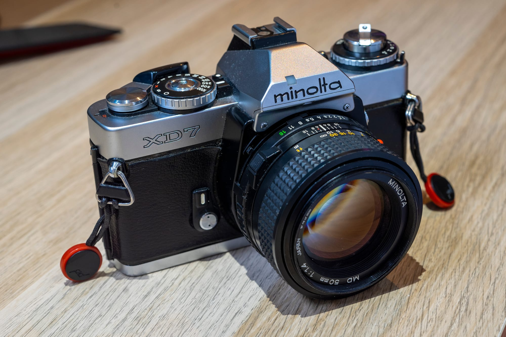

import manualScreenshot from './minolta-xd-manual-screenshot.png';
import Image from 'astro/components/Image.astro';

While I love my SR-T 101 I wanted a camera that was a bit more premium and also had some more modern features. On top of that, having the same lens mount would be ideal as I wouldn't have to assemble yet another collection of lenses for a new mount.

Enter the Minolta XD (also known as the XD-7 and XD-11): this seemed like the perfect choice. By many it's regarded to be the best camera Minolta ever made, and so far I think I have to agree with them. It's an extremely well built camera: metal wrapped in leather with a smooth winding lever and a nice shutter button, well-thought-out ergonomics, a lighter and more compact body than the previous SR mount cameras, an amazing focusing screen, automatic exposure modes, support for an autowinder: this camera really has it all.

Coming from the SR-T 101 it felt weird that I had to have a battery in the camera for it to function properly. But thankfully it takes LR44 or SR44 batteries which are readily available and you can always carry some extra with you as they are small and weigh nothing. But fear not: the camera also has a backup "O" shutter speed that is a fix 1/100th of a second and requires no batteries, just like the Bulb mode; which is very important as you can have battery life issues for very long exposures with cameras where keeping the shutter open drains the battery very quickly (especially in colder environments, so doing night photography or even astro photography on a cold night gets nigh impossible).
Alas it could have more shutter speed options in either directions: for example something like the Canon New F-1 goes down to as low as 8 seconds and goes up to 1/2000th while some other cameras with a similar vertically traveling metal shutter design go as fast as 1/4000th. Though it could be argued that for most emulsions at anything over 1 seconds reciprocity failure kicks in and also any small deviations in timing will matter less and less, and for shorther speeds you could just carry some ND filters. But for the pinnacle of manual Minolta cameras I would have loved some more options.

As for actually using the camera: it's just magnificent. The short-throw winding lever is smooth and satisfying. The shutter button has a very short and smooth travel but it's still easy to press it only halfway to check metering without accidently firing it. The focusing screen is super bright and has all the information you'd ever need. There were a few different focusing screens available for this camera where each one had a different focusing aid (or the lack thereof). As per the Rokkor Files these were the available options:

- PM (standard screen with horizontal split image bi-prism surrounded by a microprism ring)
- AP (diagonal split image bi-prism)
- M (micro-prism circle)
- G (plain Acute-Matte™ screen with no focusing aid)

Out of these I have the PM. Maybe the AP would be more ideal in some situations but I'm still extremely happy with this setup.
And once you fire the shutter: the pneumatically dampened mirror moves up and down so smoothly that you don't even really feel the mirror slap.
And the sound... oh boy. Firing this camera is straight up addictive.

My biggest gripe with the camera is the shutter speed dial. It's great that it overhangs the front of the camera just a bit: that makes it possible to change the shutter speed without changing your grip on the camera and having all the information in the viewfinder means you don't even have to take your eye away from it while doing so. However it just feels a bit too difficult to move the dial for that to be comfortably possible. It's possible that it's only my copy that has this problem, though I've seen at least one other person make a similar comment about the stiff dial so who knows.
At least the winding lever is designed in such a way that you first have to move it out of its resting position before actually activating the winding mechanism so you can comfortably grab onto the dial with 2-3 fingers from two sides.

<figure class="image-card">
    <Image src={manualScreenshot} alt="Picture from a Minolta XD-11 user manual showing how to rotate the shutter speed dial with the winding lever moved into its outer position"/>
    <figcaption>Source: Minolta XD-11 User Manual</figcaption>
</figure>

The other drawback of the camera comes from the fact that it came out at a time when camera manufacturers still weren't all-in on fully electronic cameras but Minolta decided to create a very sophisticated camera that - for the first time ever - combined a selectable Shutter speed priority mode as well as an Aperture priority mode. It also had a "hidden" program mode: if you use Shutter speed priority the camera can override your preferred setting if it can't achieve a proper exposure. So if you set the shutter speed dial to 1/125th in Shutter speed priority you basically have a Program mode.
With all these features the XD is a weird combination of mechanical and electronic internals in a pretty compact package. Thus it can be a pain in the ass to service it, so not every camera repair person is willing to work on these anymore.

The earlier models - just like mine - also had a problem with the leatherette shrinking, ending up pretty ugly. Thankfully that's a fairly easy fix and there is a nice selection of lasercut replacement leathers for this camera so I'll have to get onto that at some point, such a nice camera deserves to look pristine as well.

